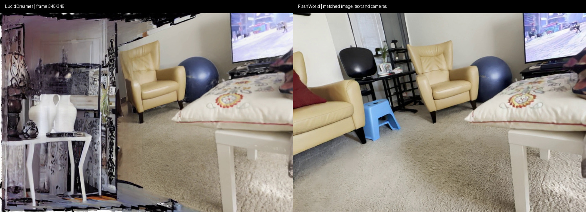
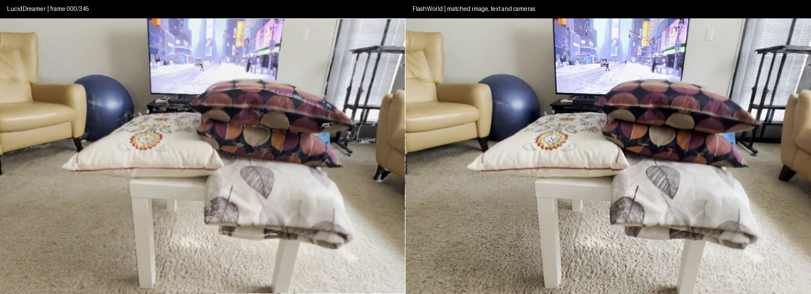
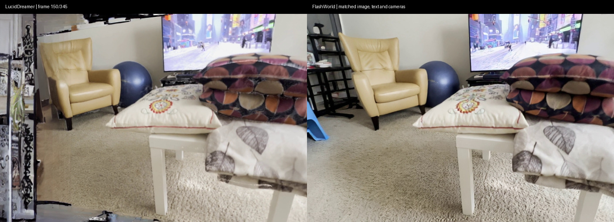

# World Scene

**单图与文本条件的三维场景生成、相机控制，以及 FlashWorld / LucidDreamer 的可复现对照。**

本仓库提供研究复现与实验封装，模型方法归原作者所有。公开源码版 **v0.10.2** 对齐内部实验版 v0.10.0；历史结果保持原始版本身份，不将公开整理误写成重新训练或重新实测。

## 同条件样例

客厅固定中心向左转 40°。两侧使用相同图片像素、用户文本、内参、24 个生成相机、346 个视频相机、704×480、15 fps 和 seed 整数 0。白底统一；模型专有算法、内部文本前缀和栅格化器各自保留。

**左：LucidDreamer；右：FlashWorld。点击图片下载完整对比视频。**

| 输入附近 | 中段 |
| --- | --- |
|  |  |

- [对比视频 MP4](https://github.com/river-ya/world-scene/releases/download/v0.10.2/paired-room40-side-by-side.mp4)
- [FlashWorld 三维样例 SPZ](https://github.com/river-ya/world-scene/releases/download/v0.10.2/flashworld-room-left40.spz)
- [附件 SHA256](https://github.com/river-ya/world-scene/releases/download/v0.10.2/SHA256SUMS)
- [冻结输入与结果元数据](examples/paired-room40/) · [对照条件及局限](docs/RESULTS.md) · [复现指南](docs/REPRODUCIBILITY.md)

该例在 RTX 4090 完成，末端新区域的结构与纹理差异可见。它是开发样例，不是总体模型排名；新区域没有真实图像监督。视频使用同帧拼接，未锐化、补帧或改变播放速度。预览图和视频有展示编码，三维参数不作增强。

## 当前能力与证据

| 内容 | 实际状态 |
| --- | --- |
| FlashWorld 图文 → 三维高斯 | 室内样例已完成，输出 PLY/SPZ/MP4 |
| LucidDreamer 十例多样相机 | 十例技术完成；来自八张源图，视觉失败案例保留 |
| 客厅同条件对照 | 两模型和白底重渲染完成；输入与真实相机数学核验通过 |
| 原子回执与相机协议 | 代码/CPU 检查；集群配额及任务状态单独核查 |
| 原论文训练/蒸馏 | 本仓库未复现完整训练 |
| 动态状态预测与物理规律 | 当前未实现；任务为静态场景生成 |

GPU 结果来自内部 v0.10.0。公开源码通过源文件完整性、CPU 测试和 Shell 语法检查；CI 不运行 GPU 推理，部分测试需要额外依赖或外部开发图片。

## 快速开始

~~~bash
git clone https://github.com/river-ya/world-scene.git
cd world-scene
python3 -B tools/check_public.py
python3 -B -m unittest discover -s tests -v
~~~

固定第三方源码快照已包含在 upstream，无需初始化子模块。权重单独按锁文件下载；缺少依赖或外部开发图片时，部分 CPU 测试明确跳过。

当前安装、Slurm 提交、实时日志和结果导出统一见 [复现指南](docs/REPRODUCIBILITY.md)。两模型使用独立环境；FlashWorld 的 4090 配置采用 T5/VAE CPU offload，申请 96G 主机内存和单张 GPU。

## 文档与结构

- [FlashWorld 详细架构：模块、张量、三维反馈和量化](docs/FlashWorld架构详解.md)
- [实验结果与同条件说明](docs/RESULTS.md)
- [LucidDreamer 来源与适配](docs/LucidDreamer适配说明.md)
- [数据与实验协议](docs/数据与实验协议.md)
- [当前版本复现](docs/REPRODUCIBILITY.md)
- [展示资产与下载](docs/ARTIFACTS.md)

~~~text
tools/       资产校验、输入、模型运行与导出
configs/     固定 revision、摘要、数据划分和公开来源
slurm/       FlashWorld 作业和同条件单例
slurm/lucid/ LucidDreamer 独立环境与作业
examples/    小型冻结输入、相机和结果元数据
assets/      轻量展示图片
tests/       CPU、完整性、相机与模拟调度检查
docs/        架构、实验协议、结果与当前复现入口
upstream/    固定第三方源码及各自许可证
~~~

权重、全量数据、原始日志、环境、PLY/MP4 不进入 Git 历史。少量视频和 SPZ 通过 Release 分发。

## 来源与许可

模型与任务依据：[FlashWorld](https://arxiv.org/abs/2510.13678)、[LucidDreamer](https://arxiv.org/abs/2311.13384)、[WorldScore](https://haoyi-duan.github.io/WorldScore/)。

第三方源码、权重和数据保留各自来源及条款。自有封装的许可证尚未单独指定，整个仓库不标为统一 MIT。见 [LICENSING.md](LICENSING.md)、[THIRD_PARTY.md](THIRD_PARTY.md)。展示输入来自作者随代码提供的室内示例。
