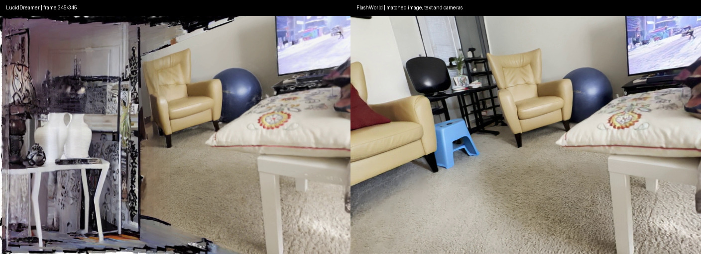

# 实验结果与证据

核查日期：2026-11-03。结果来自内部 v0.10.0，不冒充公开整理版 v0.10.1 的新 GPU 实测。

- LucidDreamer 十例均有 complete 记录和 PLY/MP4/逐视角 PNG；共八张源图，变体不计作独立场景。
- FlashWorld 客厅同条件运行完成，种子 0、RTX 4090，原生 PLY/SPZ/MP4 均存在。
- 同一 LucidDreamer PLY 的白底重渲染完成，没有重新优化场景。
- 同步左右视频完成，输入像素、文本、内参、24/346 个相机及帧率已核验。

## 客厅左转 40° 条件

| 项目 | 共同条件 |
| --- | --- |
| 输入 | 作者官方客厅图片，裁剪后 704×480 |
| 文本 | A white coffee table with pillows on it is shown in a living room. |
| 相机 | 固定中心，局部水平左转 40°，smoothstep 缓动 |
| 锚点 / 生成视角 | index 0 / 24 个 |
| 视频 | 346 帧、15 fps |
| 种子 | 同一个整数 0，不是跨模型相同噪声张量 |
| 背景 | 展示均为白底，各自原生渲染器 |

完整数据见 [result-summary.json](../examples/paired-room40/result-summary.json)。文件摘要保存在元数据中，公开附件摘要见 Release 的 SHA256SUMS。

FlashWorld 保留官方内部 [Static] 前缀、四步生成、BF16/量化及 CPU offload。LucidDreamer 保留 SD1.5 每视角 50 步、ZoeDepth 与 2990 步高斯优化。模型专用算法和精度不强行设为相同。

## 可观察到的现象

左侧新进入画面的区域有条带、破碎边界和明显接缝；右侧在该样例中新区域衔接较连贯。未知区域没有真实参考，右侧新增家具同样属于生成内容，不能据此认定它恢复了真实房间。

逐步补图误差累积是一种机制解释；最终视频不足以定位具体错误最先出现在补图、深度融合还是高斯优化。未发布正式 WorldScore 排名，不将一个样例推广成全局优劣。

## 效率与版本

FlashWorld 原始记录约 3683 秒，包含模型加载，最大已分配显存约 11.61 GiB，采用 T5/VAE CPU offload。LucidDreamer 该例生成与优化阶段合计约 32.6 分钟；系统负载和阶段划分不同，白底重渲染额外执行。保留记录，不作严格速度比。

原始运行采用 v0.10.0 / b2f217072acb6155f65cafbca0a0b77087a4f1f1。公开源码可重新生成同条件输入，GPU 算子不保证逐位一致。预览 JPEG 来自同步 PNG，没有锐化或几何处理；拼接 MP4 有再次编码，未改变播放速度或补帧。
