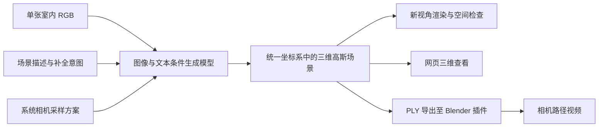

> 历史实验文档：个人部署信息已替换为示例值。公开版实际操作以 [SLURM.md](SLURM.md) 为准，旧版本命令不应直接复制到新版目录。

# 单图与文本条件下的室内三维场景生成及世界状态演化研究

更新：2026-10-16。截止：2026-11-01。执行者：1 人。资源：最多 4 张 RTX 4090。

状态：v0.1.3 的客厅与音响房间已在 4090 上完成推理，用户认可效果。v0.2.0 准备十案例输入和提交入口；新场景 GPU 效果仍待验收。用户已确定以网页播放预生成视频为当前展示交付，优先跨模型比较，实时生成、网页自由漫游与 Blender 不作为展示前置条件。执行以 v0.2.0 专项指南和 CHANGELOG 为准。

配套文件：[论文与选型依据](论文与选型依据.md)、[Slurm 执行指南](Slurm执行指南.md)。

## 1. 已确认的任务

| 项目 | 确认后的要求 |
|---|---|
| 主任务 | 三维场景生成：理解输入场景，合理补全未知区域 |
| 输入 | 单张 RGB 图像＋文本；第一阶段以室内场景为主 |
| 一致性 | 已观测物体、布局和外观基本保持，未观测区域允许合理生成 |
| 三维成果 | 保存具有空间结构的三维资产，在生成区域内自由切换视角 |
| 展示 | 网页浏览可以采用；Blender＋3DGS 插件可以采用，并能渲染视频 |
| 范围扩展 | 完整房间、较大范围漫游作为提升项 |
| 物体编辑 | 不要求每个物体独立建模、独立编辑 |
| 微调 | 可选，取决于基线失败分析、训练代码与资源可行性 |
| 后续科研 | 交互条件下世界状态演化、动态场景建模、未来状态预测 |
| 旧 PPT | 前四页任务与最后一页流程均非硬性要求；Dec3D 不纳入选型 |

依据：用户最新答复、《新项目1.docx》及《具体要求.pptx》。原文件只用于要求对照；旧桌面动作预测代码及数据不作为本次设计前提。

建议课题名称使用“单图与文本条件下的室内三维场景生成及世界状态演化研究”。11 月 1 日成果应标明完成了其中的三维场景生成阶段；若尚未做动态实验，不写成已实现动作条件世界模型。

## 2. 核心技术建议

### 2.1 首选验证 FlashWorld 的公开推理基线

选择理由：任务输入匹配，直接输出显式 3DGS，公开推理代码和权重可查，具备 CPU 卸载路径；无需先搭建物体分割、独立网格生成、场景拼装的整套系统。它利用视频生成先验及三维解码进行场景生成，符合本项目生成大模型方向。[论文](https://arxiv.org/abs/2510.13678)、[代码](https://github.com/imlixinyang/FlashWorld)。

建议第一阶段保持官方架构，先完成复现，再根据失败案例选择改进。推理代码已核对同时接收 `image_prompt`、`text_prompt` 和相机参数，输出 `gaussians.ply`；本地源码检查版本为 `424db4487de308a39e5137afbe85e7568a96193f`。[CLI 源码](https://github.com/imlixinyang/FlashWorld/blob/424db4487de308a39e5137afbe85e7568a96193f/cli.py)。



相机参数是系统生成与评测的控制量，不增加用户必须拍摄多视角图像的要求。模型产生的多视角或视频是推理内部过程/渲染结果。数据集中的其他真实帧可以用于评测，不能全部喂给单图基线后仍声称是单图生成。

文本第一阶段表达房间类型、可见布局与补全意图，不承担“推椅子后运动”的动作监督。描述已有场景和修改已有场景是不同任务；先测试“图片＋忠实描述”和“图片＋不冲突的补全提示”。强行改动物体位置不作为基础通过条件。

### 2.2 资源与实现边界

- 首次用 1 张 4090，开启官方低显存卸载，运行一个官方室内样例。剩余卡用于后续独立样本并行；初期没有必要申请四卡训练。
- 四张 24GB 卡不自动成为一张 96GB 卡。官方单卡推理不会因申请四卡而自动分片。
- 官方基准来自其他 GPU；4090 的速度、CPU 内存峰值、FP8 算子兼容性必须实测。
- 公开推理主干依赖 Wan2.2-TI2V-5B 相关组件及 FlashWorld 权重，已查到所需文件总大小约 55.14GB（十进制，不含环境、缓存及输出）。规划至少 120GB 可用空间只是工程预算，下载前应核实磁盘。
- 初始 Slurm CPU 内存请求按旧指南使用 96G，CPU 8 核；是否足够以加载实测为准。
- 官方训练代码通过表单申请获取，不承诺公开推理仓库具备完整可直接使用的训练入口。取得代码、确认权重可训练及显存可行性后，才安排微调。[官方说明](https://github.com/imlixinyang/FlashWorld)。

### 2.3 比较与备用方法

| 方法 | 在本项目中的位置 | 主要代价与边界 |
|---|---|---|
| FlashWorld | 推荐首先复现，作为显式 3DGS 基线 | 生成覆盖范围与细节质量需实测；当前是静态场景 |
| HunyuanWorld 1.0 | 若希望比较全景补全与 Mesh 表示，可作为第二基线 | 全景覆盖不等于房间内任意位置都有完整几何；分层结构需要实测 |
| Scene Splatter | 若重点转向逐步扩展及跨视角一致性，可作为研究对照 | 多组件与逐场景优化增加复现成本 |
| HY-World 2.0 | 论文调研和后续能力对照 | 完整生成链路的资源与训练可用性需单独核实，不能用重建分支替代生成分支验收 |

这些是备选关系，不建议在两周内全部安装或拼接。若首选基线连续两天仍无法完成“生成 PLY→独立查看”的闭环，记录阻塞原因，与用户确认是否改用备用路线。

## 3. 数据设计

### 3.1 第一阶段先用评测数据，无须先建立大规模训练集

| 数据 | 推荐用途 | 论文依据与边界 |
|---|---|---|
| 官方室内样例 | 环境、推理、导出连通性检查 | FlashWorld 官方样例；不计入独立泛化成绩 |
| WorldScore 中的室内静态场景子集 | 图文条件、相机探索与生成质量评估 | WorldScore 是世界生成评测；子集结果必须单列，不能写成完整榜单复现 |
| DL3DV 独立评测集中的室内子集 | 输入一帧，其余帧/相机参数仅作几何与新视角参考 | FlashWorld 使用 DL3DV 类多视角数据；官方提供独立评测集。仍需核查具体模型训练交集 |
| RealEstate10K | 后续室内域微调或补充对照的候选 | FlashWorld 使用该类数据；原始视频下载可用性及具体划分需要核实 |

推荐先做 2 个官方室内样例、6 个开发场景，再冻结 12 个独立测试场景；其中生成测试和有真实参考测试分别统计。样本量是本项目排期建议，不是论文标准。可额外加入 3 个自有室内样例检验域外表现，单列为定性案例。

DL3DV 需要访问申请；申请未通过时先做官方样例和 WorldScore 子集，不假称已完成真实参考评测。不下载全量 10K 数据。数据选择与最终 ID 清单在实施时记录，不根据生成效果挑选“好看的测试样例”。

### 3.2 单个样本的数据契约

保存样本 ID、数据来源/版本、原场景 ID、划分、输入 RGB、人工核对的文本、相机内参及轨迹、坐标约定、参考帧路径、遮挡/反射等标签。若修改尺寸或裁剪，记录原尺寸、变换与更新后的内参。

图文提示只由条件图像及允许的用户需求形成；生成时不可用隐藏参考帧写出“背面物体”等信息，否则会泄漏答案。单图生成区域的尺度通常存在歧义，不能直接当成米制测量。

划分按房间/原视频进行，禁止同一房间相邻帧跨训练与测试。微调训练样本不使用上述冻结测试场景。公开模型的完整预训练交集若无法审计，报告中明确说明。

## 4. 实验与验收

### 4.1 四项基础验收

1. 保存一个真实可加载的 3DGS 文件，关闭生成进程后仍可重新打开。
2. 同一份场景资产支持相机旋转及平移；以近远物体的视差、遮挡变化证明存在空间结构。只展示固定轨迹 MP4 不足以验收。
3. 查看未参与生成的插值/偏移视角，检查空洞、漂浮碎片、重复物体、墙面弯曲、尺度失调。记录可用区域及越界失败情况。
4. Blender 插件加载相同 PLY，保存 `.blend` 并输出一段相机路径视频；和原生 3DGS 渲染对照，区分模型误差与插件误差。

### 4.2 推荐的小规模对照

- B0：图片＋空文本。
- B1：图片＋忠实描述。
- B2：图片＋忠实描述＋不冲突的未知区域补全要求。
- C：对 B1 固定输入与随机种子，改变相机采样范围，评估覆盖与失真之间的关系。

主要比较图文条件是否带来收益，以及扩大探索范围的质量代价。这些是基线分析，不包装成算法创新。开发集先固定参数，再跑测试集；可选随机种子为 0、1、2，正式执行时记录实际种子与非确定性算子限制。

### 4.3 指标需要对应能验证的能力

| 维度 | 记录方式 | 解释限制 |
|---|---|---|
| 输入保持 | 原视角回渲染，与经过相同裁剪的输入比较 PSNR/SSIM/LPIPS，结合可见物体人工检查 | 不能反映背面是否合理；未完成坐标对齐不报告像素指标 |
| 真实参考一致性 | 有相机真值场景上的隐藏视角渲染；按重叠/新显露区域分别分析 | 未观测内容允许多解，偏离真实隐藏物体不一定是不合理生成 |
| 空间结构 | 固定轨迹与额外偏移视角的结构缺陷统计，检查视差、墙地关系及遮挡 | 同一静态资产闭环回到原位置会自然一致，不能单独证明世界记忆能力 |
| 文本响应 | 预先列出要求，检查满足率；WorldScore 相关维度可作补充 | 不同评价器与采样方案不得混成同一榜单分数 |
| 效率 | 生成/渲染分开计时，GPU 峰值、CPU 峰值、资产大小、成功率 | 写明硬件、卸载设置、分辨率及视角数 |
| 展示兼容性 | 网页及 Blender 加载、视角操作、视频导出是否通过 | 插件可用与模型几何正确是不同结论 |

WorldScore 可提供生成评测方法依据；它的完整评价链有多项依赖，短周期可先做明确定义的子集。FlashWorld 作者对其采样与相机指标提出过修订，报告必须标明使用原版、修订版还是本项目自定义协议。[WorldScore](https://github.com/haoyi-duan/WorldScore)、[FlashWorld 评测说明](https://github.com/imlixinyang/FlashWorld#clarification-on-worldscore-evaluation)。

## 5. 世界模型研究如何继续

阶段一建立可持久化的场景状态 `S0`。它能支持后续研究，但当前静态场景生成本身不能证明学会了动作响应或时间演化。

后续研究目标可写为：在给定当前场景状态、动作及历史观测时，预测未来状态分布，并从任意评测相机渲染未来场景。

```text
S0 = G(输入图像, 文本, 场景生成条件)
S(t+1) ~ F(S(t), 动作 a(t), 历史观测, 不确定的物理属性)
I(t+1, c) = Render(S(t+1), 相机 c)
```

推荐后续先限制为室内局部物体/区域的一种交互，而非整间房的任意物理变化。即使不要求独立 Mesh，仍需运动区域与背景的区分、状态对应和遮挡补全。运动区域掩码、粒子分组或形变场可作为实现途径，具体方法需另行选型。

三条可研究的方向：

1. **视频生成先验驱动的交互响应。** PhysDreamer 用生成视频的运动先验支持三维物体动力学，适合作为大模型先验通向动态场景的参考，但不能直接保证房间内任意动作可预测。[论文](https://arxiv.org/abs/2404.13026)。
2. **高斯表示中的物理演化。** PhysGaussian 提供仿真与高斯渲染的共同表示，可作为物理对照；只指定材料参数运行仿真不等于从数据学到世界规律。[官方实现](https://github.com/XPandora/PhysGaussian)。
3. **根据交互视频校准，再做新动作预测。** PhysTwin 为从视频估计物理状态及未来交互提供参考；这要求额外动态观测，不能凭单张 RGB 唯一恢复质量、摩擦和刚度。[论文](https://arxiv.org/abs/2503.17973)。

真正的科研增量可围绕：同一个动作在多个视角下运动一致，变化区域之外的背景保持，遮挡后的物体身份保持，以及预测误差随时间积累。对照应含无变化、简单运动外推、指定物理参数仿真和学习模型。需要单独构建动作—时间—状态数据，静态多视角数据不能替代。

本轮不指定新的动态训练集，也不把这些方法直接拼接为已验证架构。动作类型、额外视频获取方式与后续周期需要在阶段一结果出来后确认。

## 6. 10 月 16 日至 11 月 1 日建议排期

| 日期 | 主要工作 | 阶段产物与切换条件 |
|---|---|---|
| 10/16–10/17 | 确认推荐路线、准备环境/权重、完成单样例实测 | 一个可重开 PLY，资源记录；失败则定位而非启动大规模训练 |
| 10/18–10/20 | 官方室内样例、自有输入，网页与 Blender 闭环 | 生成、换视角、导出、渲染均可执行 |
| 10/21–10/24 | 整理开发/测试清单，运行 B0/B1/B2 及视角范围实验 | 冻结实验配置，整理失败类型 |
| 10/25–10/27 | 根据结果开展一个小改进，或扩展误差分析 | 微调仅在代码、数据、显存均通过后启动；不从头训练 |
| 10/28–10/30 | 最终测试、展示素材、报告与复现说明 | 保留全部测试结果，不只挑最佳案例 |
| 10/31 | 完整演练、文件重开、导入及导出校验 | 冻结可交付版本，补齐失败说明 |
| 11/01 | 汇报交付 | 三维资产、演示视频、实验表、调研与后续研究路线 |

微调若不可行，可用规范复现、图文条件对照与视角范围分析完成本阶段。动态预测只有在静态三维成果已稳定且获得额外数据时才加做独立预实验，不把它列为这 16 天必然完成的指标。

## 7. 交付与执行边界

交付包括：原始图文输入与版本记录、PLY/SPZ、相机参数、评估结果、成功与失败案例、可重开的 Blender 工程、相机视频、Markdown 操作手册。网页优先复用基线查看能力，不把开发新网站作为前置任务。

现有 Slurm 文档只复用环境事实：节点 `GPU1`、分区 `debug`、账号 `stu`、QOS `normal`、根目录 `/shared/your_user`；集群状态应由 `sinfo/scontrol/sacct` 再核验。

用户已确认采用 **FlashWorld 首选基线＋WorldScore 室内子集＋DL3DV 独立评测室内子集**，并要求版本维护。实际脚本与固定数据清单位于本仓库。SSH 地址已确认为 `your.cluster.example`，当前执行环境认证失败；Blender 版本、DL3DV 访问与 GPU 效果仍待部署核验。后续有影响研究范围的选择继续向用户确认。
